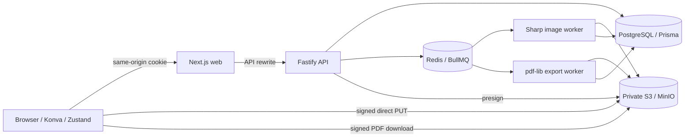

# PhotoForge

**Your moments. Beautifully bound.** A photobook studio built around a Next.js application, a modular Fastify API, PostgreSQL, Redis, object storage, and independent image/PDF workers.

Create a private guest workspace, choose a template, upload photographs directly to object storage, arrange pages in a Konva editor, save a versioned document, and request a downloadable PDF. A deliberately simulated checkout records orders without collecting payment details or shipping products.

**[Open the live demo](https://photoforge-chirag.duckdns.org)** · [Architecture](docs/architecture.md) · [API contracts](docs/api.md) · [Local setup](#local-startup)

## Try the demo

Open **https://photoforge-chirag.duckdns.org** and choose **Try the creative studio**. No registration or payment information is required.

1. Create a photobook from a template.
2. Upload a small JPEG, PNG or WebP photo and place it on a page.
3. Add text, adjust the layout and save.
4. Refresh to check persistence, then preview and request a PDF export.
5. Download the completed PDF or explore mock checkout and order history.

The demo is hosted temporarily on a small AWS EC2 instance. Availability may change, and image/PDF processing may be slow under load. Use sample photos; guest sessions last 24 hours, and demo data may be reset. Session expiry does not itself delete uploaded files.

## Live AWS deployment

The running demo uses a manually configured, single-server deployment:

| Component      | Current demo                                                                       |
| -------------- | ---------------------------------------------------------------------------------- |
| Compute        | AWS EC2, Ubuntu 26.04 LTS, approximately 1 GB RAM plus 1 GB swap                   |
| Application    | Prebuilt Docker image, with separate Next.js, Fastify and BullMQ worker containers |
| Database       | PostgreSQL 17 container with a persistent Docker volume                            |
| Queues/cache   | Redis container with persistence                                                   |
| Photos/PDFs    | Private MinIO storage on EC2 with signed browser upload/download URLs              |
| HTTPS          | Host Nginx reverse proxy and a Let's Encrypt certificate for the DuckDNS hostname  |
| Website        | HTTPS on port 443; Next.js is bound to localhost on port 3000                      |
| Storage access | HTTPS on port 9443; MinIO's HTTP API and management console are bound to localhost |
| Delivery       | Image built on the developer's computer and streamed to EC2 over SSH               |

The current demo uses **EC2-hosted PostgreSQL and MinIO**, rather than managed RDS or AWS S3. Terraform, ECR/SSM deployment, CloudWatch logging and GitHub Actions release configurations are provided for the managed-service deployment path; that path has not been verified as the live environment. CloudFront, ElastiCache, autoscaling and high availability are not active in the demo.

EC2 container health checks and an HTTP 200 frontend response were confirmed during deployment; HTTPS reachability was subsequently confirmed by the owner. Complete browser-flow verification, certificate-renewal testing and load benchmarks must be recorded separately. Earlier [validation records](docs/validation.md) describe checks performed before this manual deployment and retain their historical limitations.

The prebuilt-image setup uses `docker-compose.yml` plus `infrastructure/compose.demo.yml`. HTTPS configuration is applied last through `infrastructure/compose.https-demo.yml`, with host Nginx configured using `infrastructure/nginx-demo.conf.example`. The checked-in HTTPS templates use an IP placeholder; adapt the Nginx server name, certificate paths, `WEB_ORIGIN`, storage signing endpoint and MinIO origin to the hostname when deploying with a domain. Keep the exact browser origin consistent, including scheme and any nonstandard port.

PostgreSQL, Redis and the MinIO console are not publicly exposed. Keep HTTP port 80 available for certificate validation and HTTP-to-HTTPS redirects. Configure and verify automatic certificate renewal and Nginx reloads before leaving the demo unattended. If EC2's public IP changes, update the DuckDNS record.

For a future managed-service deployment, follow [First AWS deployment](docs/aws-first-deployment.md) and [Deployment and operations](docs/deployment.md).

## Local startup

Prerequisites: Docker Engine with Compose v2.24.4+, at least 4 GB available memory, and access to container/package registries. Node **24 LTS** and pnpm 10.28 are needed only for host development.

```bash
cd photoforge
cp .env.example .env
# Replace CHANGE_ME values in .env. Use different random values for database,
# JWT and S3 secrets. Keep the password in DATABASE_URL aligned with POSTGRES_PASSWORD.
docker compose up --build -d --wait --wait-timeout 300
```

Open **http://localhost:3000** and choose **Take a look around** or **Try the creative studio**. Guests get independent, private 24-hour accounts, with 50 books, 200 uploads and 100 exports per workspace. No shared demo identity or browser-only project storage is used.

- API and Swagger UI, through the frontend: http://localhost:3000/api/docs/
- OpenAPI JSON: http://localhost:3000/api/docs/json
- Liveness / readiness: `/api/health`, `/api/ready`
- Local object storage API: http://localhost:9000 (private bucket, signed access).
- Local MinIO browser console: http://localhost:9001 (login with `S3_ACCESS_KEY` / `S3_SECRET_KEY` from your `.env`).
- PostgreSQL and Redis have **no published ports**.

To inspect uploaded images, open the MinIO console, select the bucket named by `S3_BUCKET` (normally `photoforge`), and browse `users/<user-id>/books/<book-id>/`. Raw uploads are under `originals/`; validated source images, optimized WebP images, and thumbnails are under `processed/`; generated PDFs are under `exports/`. For an existing stack, expose the console with `docker compose up --no-build -d --no-deps --force-recreate minio`. The existing `s3-data` volume is preserved.

```bash
docker compose logs -f api worker
docker compose exec api pnpm db:migrate
docker compose exec api pnpm db:seed
# Stop, preserving data:
docker compose down
# Destructive local reset, only when intended:
docker compose down -v
```

Compose builds the shared image, waits for the database and Redis, creates a private local MinIO bucket and CORS configuration, runs the committed SQL migration and template seed, then starts the application. The local environment sets `NODE_ENV=development` so HTTP cookies work on localhost. Production sets secure cookies and requires HTTPS.

Local MinIO uses a digest-pinned [Coollabs community build](https://github.com/coollabsio/minio/pkgs/container/minio/552228199?tag=RELEASE.2025-04-22T22-12-26Z), because the original `minio/minio` Docker Hub image is unavailable. This service is used for local development and the temporary EC2 demo; the managed-service deployment configuration uses AWS S3. If you have an older checkout that fails while pulling `minio/minio`, update the Compose image reference and run `docker compose pull minio` before retrying startup. No volume reset is needed.

The generated local `.env` is ignored by Git and excluded from Docker builds. `.env.example` contains placeholders, never production credentials.

## Stack

| Area         | Implementation                                                       |
| ------------ | -------------------------------------------------------------------- |
| Web          | Next.js App Router, React, strict TypeScript, Tailwind, React Konva  |
| Client state | Zustand snapshots for undo/redo; TanStack Query for API state        |
| Forms        | React Hook Form and shared Zod contracts                             |
| API          | Fastify, Zod, Swagger, Pino, request IDs, rate limits                |
| Data         | PostgreSQL, Prisma, committed migration, transactional page saves    |
| Jobs         | BullMQ / Redis, bounded exponential retries, retained failed jobs    |
| Media        | S3-compatible direct uploads, Sharp processing, private signed URLs  |
| Export       | pdf-lib, original-resolution images, PDF text, bleed and trim boxes  |
| Delivery     | Docker Compose, GitHub Actions, AWS EC2/RDS/S3 configuration         |
| Tests        | Jest, React Testing Library, Fastify inject, Playwright, k6 scenario |

Node 24 is an LTS release ([official release schedule](https://github.com/nodejs/Release)). Package ranges satisfy Next.js 14+/React 18+ while targeting the newer Next.js 16/React 19 APIs, including asynchronous route parameters. The committed lockfile pins resolved dependencies. Compatibility checks and CI must pass for each release.

## Architecture



This is one modular application with independently deployable execution roles. There are no unnecessary networked business microservices. [Architecture and engineering trade-offs](docs/architecture.md) explain the data model, queues, concurrency, and scaling path. [API contracts](docs/api.md) list routes and workflow examples.

```text
apps/web/                 pages, reusable UI, Konva canvas, Zustand editor
apps/api/src/modules/     auth, templates, photobooks, images, exports, orders
apps/api/src/books.ts     book ownership, asset validation, transactional saves
apps/worker/              independent image processing and PDF generation
packages/shared/          Zod contracts, document types, pricing and adapters
infrastructure/prisma/    relational schema and initial SQL migration
infrastructure/aws/       opt-in Terraform configuration; never auto-applied
infrastructure/           Docker, storage initialization, deploy and load scripts
docs/                     architecture, API, security, operations and validation
tests/                    unit, component, real integration and browser tests
```

## Features and interaction

- Landing page, registration/login, dashboard, template gallery, editor, preview, export status, checkout, and order history.
- Five editable templates: travel, wedding, family, birthday and minimal. Templates include photo slots, text, page backgrounds and configurable geometry.
- Click or drag a processed photo onto a slot. It fills the slot with a centered crop; free placement remains available elsewhere.
- Drag elements, use corner handles to resize and the rotation handle to rotate. The properties panel supports precise geometry and normalized crop controls.
- Add text; change font, size, alignment, and color. Set backgrounds and physical page dimensions. Manage element order and page duplication/removal.
- Keyboard: `Ctrl/Cmd+Z`, `Ctrl/Cmd+Shift+Z`, arrow keys, `Shift+arrow` for ten-unit moves, `Delete`, and `Escape`. Input fields keep their normal keyboard behavior.
- Debounced autosave, bounded undo history, revision checks, save-before-preview/export/order, and an unsaved-change unload warning.
- Photos: JPEG, PNG, WebP, at most 20 MB and 60 megapixels; animated files are rejected. Processing strips metadata, applies orientation, and generates 3200 px optimized images and 360 px thumbnails.
- Failed uploads/processing can be retried. Queued/processing state is polled; failed jobs remain inspectable.
- Export snapshots are tied to saved revisions. PDF downloads expire after 15 minutes; refresh the status page to renew the link.
- Unfilled template slots are editor guides and are omitted from preview/PDF.
- Mock checkout checks actual page count/dimensions and calculates integer-cent prices on the server. An idempotency key prevents duplicate orders.

The editor lays out logical coordinates on a 1000-unit-wide trim area. Page height follows the physical aspect ratio. Changing physical dimensions does not automatically reflow existing elements.

## Screenshots

Actual screenshots have **not** been captured in this environment; no generated mockups are presented as running software. The Playwright workflow captures dashboard/editor/export screenshots under `test-results/` after reaching those screens. Run it against the real Compose stack, review the captures, and add approved images to `docs/screenshots/` for a portfolio release. CI retains these files as artifacts.

## Formatting and readability

Source files use two-space indentation, visible spacing between logical sections, and expanded JSX, object properties, and CSS rules. `.editorconfig` supplies editor defaults; `.prettierrc.json` defines the shared formatter settings.

```bash
pnpm format          # Format supported source, configuration, and documentation files
pnpm format:check    # Report files that differ from the Prettier style
pnpm format:prisma   # Use Prisma's schema formatter
pnpm format:terraform # Use Terraform's native formatter (requires Terraform installed)
```

Install dependencies before running these commands. Generated output, local secrets, and applied Prisma migrations are excluded from Prettier. Migration contents must retain their recorded checksums. Terraform and Prisma use their native formatters because the standard Prettier installation does not format those languages.

## Host development and checks

```bash
corepack enable
corepack pnpm install --frozen-lockfile
corepack pnpm db:generate
corepack pnpm --filter @photoforge/shared build
corepack pnpm typecheck
corepack pnpm lint
corepack pnpm test
corepack pnpm build
```

The committed `pnpm-lock.yaml` pins dependency resolution. Local setup, Docker and CI use `--frozen-lockfile`; update the lockfile intentionally when changing dependencies. Use the pinned pnpm 10.28.0 and Node.js 24.

For hot reload, keep dependencies running through Compose, stop its app processes and run the workspace dev scripts inside the service containers, or explicitly publish database/Redis ports to **127.0.0.1** in a private development override. Host `.env` defaults use localhost and do not connect to unpublished Compose databases automatically. Do not publish these ports on a production interface.

```bash
# Real Fastify/PostgreSQL/Redis tests inside the configured service container:
docker compose exec -T api pnpm test:integration \
  tests/api.integration.test.ts tests/jobs.integration.test.ts

# Browser test from the host, with services running:
pnpm exec playwright install chromium
pnpm test:e2e

# Pricing, hashing and policy tests without infrastructure:
pnpm test:offline
```

The end-to-end test signs into a new guest account, creates a book, uploads generated image bytes to real storage, waits for the worker, adds the image and text, saves, refreshes, requests an export and checks the downloaded `%PDF` bytes.

## Environment variables

| Variable                         | Purpose                                                                                                   |
| -------------------------------- | --------------------------------------------------------------------------------------------------------- |
| `DATABASE_URL`                   | PostgreSQL URL; production should use `sslmode=require` and RDS CA verification appropriate to the driver |
| `POSTGRES_PASSWORD`              | Local Compose database password                                                                           |
| `REDIS_URL`                      | Redis URL; use `rediss://` for managed TLS Redis                                                          |
| `JWT_SECRET`                     | Random secret, at least 32 characters; rotate deliberately                                                |
| `WEB_ORIGIN`                     | Exact browser origin, used for mutation origin checks and S3 CORS                                         |
| `NODE_ENV`                       | `development`, `test`, or `production`; controls secure cookies                                           |
| `PORT`                           | API port, default 4000; Compose overrides the web service to 3000                                         |
| `API_INTERNAL_URL`               | Next.js server-to-API rewrite target; no browser-visible service address                                  |
| `S3_BUCKET`, `S3_REGION`         | Private storage bucket and AWS region                                                                     |
| `S3_ENDPOINT`                    | Local MinIO endpoint; omit for AWS                                                                        |
| `S3_PUBLIC_ENDPOINT`             | Browser-reachable signing endpoint for local MinIO; omit for AWS                                          |
| `S3_ACCESS_KEY`, `S3_SECRET_KEY` | Local storage credentials; omit on EC2 to use its IAM role                                                |
| `S3_FORCE_PATH_STYLE`            | `true` for MinIO, `false` for AWS                                                                         |
| `DOMAIN`                         | Production hostname for Caddy/HTTPS                                                                       |
| `IMAGE`                          | Production immutable ECR image digest                                                                     |
| `DEPLOY_SECRET_ARN`              | Secret containing the full production dotenv document; deployment only                                    |

Next rewrites are compiled by `next build`; the internal hostname `api` is deliberately identical in local and production Compose. Rebuild if changing that hostname.

## Operations, security and deployment

- [AWS deployment, HTTPS, CI/CD and rollback](docs/deployment.md)
- [Security boundaries and limitations](docs/security.md)
- [Performance targets versus measured results](docs/performance.md)
- [Validation results and remaining gates](docs/validation.md)

Checkout is simulated: there is no Stripe integration, real payment collection or fulfillment. Stored photos and PDFs require authorization or signed URLs. Generated PDFs are not claimed to be certified print-production documents. The demo EC2 instance was created manually; repository workflows do not apply Terraform or automatically provision cloud resources.

## Known limitations and next work

The application image has been built, transferred and started on EC2. Next, complete and record the browser workflow on the live hostname, verify automatic certificate renewal, capture real screenshots, and inspect downloaded PDFs. Run the integration and end-to-end suites against the intended release configuration. Validate Terraform and perform a separately approved deployment before claiming the RDS/S3/ECR/CloudWatch path is operational.

The temporary demo uses single-instance EC2, containerized PostgreSQL/MinIO and local persistent Redis, standard Latin PDF fonts, RGB output, simple rectangular crops, one active editor per document revision, and a bounded undo history. CMYK, ICC embedding, PDF/X certification, arbitrary Unicode fonts, collaborative editing, password recovery/email verification, malware scanning, automated member asset garbage collection, and real print fulfillment are not implemented. The canvas has keyboard controls and form labels, but still needs a screen-reader usability audit. A fully accessible non-canvas editing alternative remains future work.

No measured throughput or production-traffic claim is made. The small demo server is not a capacity benchmark; it has limited disk space, memory and concurrency headroom, and no verified high-availability or off-instance backup setup.

Marketing cover photographs are remote Unsplash illustrations; they are not silently inserted into user projects. Uploaded photos stay in private object storage. Replace marketing imagery with licensed locally hosted assets before a public production release if required by the intended distribution.
